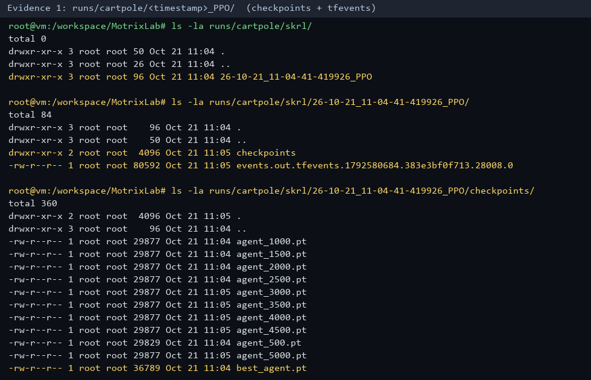
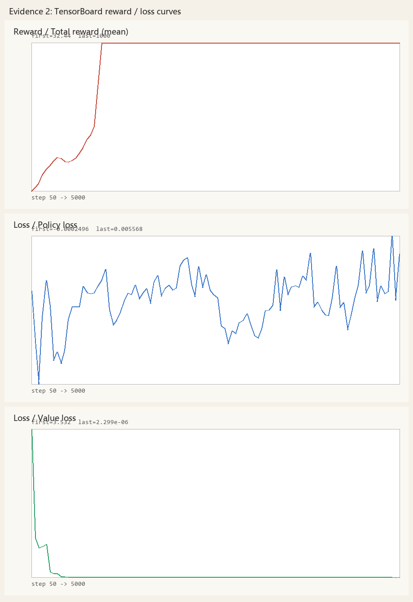
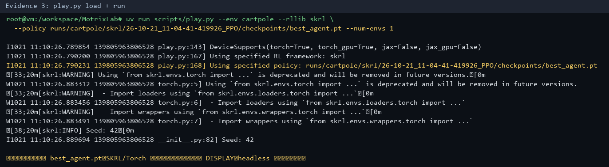

# 第7讲实操必做题 · 复现文档

姓名：于鸿伟  
对应讲次：第 7 讲（训练流程：从 `train.py` 到模型保存）  
环境：云主机 `39.145.28.59:32222`（RTX 5090）  
代码版本：**MotrixLab v0.3.0**（作业要求的 `scripts/train.py` / `scripts/play.py` 接口）

> 红线三项证据已齐：输出目录、TensorBoard 曲线+趋势结论、play 加载命令+结果。  
> 证据图片在同目录 `证据/` 下。

---

## 0. 一句话结论

cartpole 已跑通训练闭环（5000 timesteps），产物在：

`runs/cartpole/skrl/26-10-21_11-04-41-419926_PPO/`

目录内有 `checkpoints/`（含 `best_agent.pt`）和 `events.out.tfevents.*`。  
TensorBoard 上 reward 明显上升、value loss 下降；`play.py` 已成功加载 checkpoint。

---

## 1. 环境准备（只需做一次）

### 1.1 登录云主机

```bash
ssh root+vm-LEAjLhYIUQymN0v7@39.145.28.59 -p 32222
```

### 1.2 安装 uv

```bash
curl -LsSf https://astral.sh/uv/install.sh | sh
source $HOME/.local/bin/env
uv --version
```

### 1.3 克隆 MotrixLab v0.3.0

> 注意：当前 GitHub `main` 已改成 `mxlab` CLI，**没有**作业里的 `scripts/train.py`。  
> 作业命令对应 **v0.3.0**。

```bash
cd /workspace
GIT_LFS_SKIP_SMUDGE=1 git clone --depth 1 --branch v0.3.0 https://github.com/Motphys/MotrixLab.git
cd MotrixLab
git lfs pull
```

### 1.4 安装依赖（PyTorch 后端）

v0.3.0 要求 Python **3.10**：

```bash
cd /workspace/MotrixLab
uv python install 3.10
uv sync --python 3.10 --all-packages --extra skrl-torch
```

验证：

```bash
uv run python -c "import torch, motrixsim; print(torch.__version__, torch.cuda.is_available())"
```

应看到类似：`2.7.0+cu128 True`

> 坑：`motrixsim` 从 PyPI 下载可能很慢（几十分钟都正常），不是卡死。可用 `ls -lah ~/.cache/uv/.tmp*/motrixsim/*.so` 看文件是否在变大。

---

## 2. 证据 1：输出目录（8 分）

### 2.1 训练命令（不必训满 1000 万步）

```bash
cd /workspace/MotrixLab
uv run scripts/train.py --env cartpole --num-envs 256 --train-backend torch
```

说明：
- cartpole 默认约 `timesteps=5000`，几十秒就能跑完一整个闭环
- `--num-envs 256` 是为了更快；不写也行（默认 2048）
- 达标口径：≥1 个 episode 闭环 + 有日志目录即可

### 2.2 产物路径

本次实际生成：

```text
runs/cartpole/skrl/26-10-21_11-04-41-419926_PPO/
├── checkpoints/
│   ├── best_agent.pt
│   ├── agent_500.pt
│   ├── ...
│   └── agent_5000.pt
└── events.out.tfevents.1792580684.383e3bf0f713.28008.0
```

查看命令：

```bash
ls -la runs/cartpole/skrl/
ls -la runs/cartpole/skrl/26-10-21_11-04-41-419926_PPO/
ls -la runs/cartpole/skrl/26-10-21_11-04-41-419926_PPO/checkpoints/
```

### 2.3 截图



---

## 3. 证据 2：TensorBoard（10 分）

### 3.1 启动

```bash
cd /workspace/MotrixLab
uv run tensorboard --logdir runs/cartpole --bind_all --port 6006
```

浏览器打开：`http://<云主机IP>:6006`（若端口未映射，可在本机 SSH 转发）：

```bash
ssh -L 6006:127.0.0.1:6006 root+vm-xxx@39.145.28.59 -p 32222
```

然后访问 `http://127.0.0.1:6006`，查看：
- `Reward / Total reward (mean)`
- `Loss / Policy loss`
- `Loss / Value loss`

### 3.2 曲线截图



### 3.3 一句话趋势结论

**Total reward (mean) 从约 32.4 升到约 1000.0，Value loss 从约 3.53 降到约 2.3e-06，说明短训内策略已学会稳住倒立摆。**

---

## 4. 证据 3：推理演示 play.py（12 分）

### 4.1 命令

```bash
cd /workspace/MotrixLab
uv run scripts/play.py --env cartpole --rllib skrl \
  --policy runs/cartpole/skrl/26-10-21_11-04-41-419926_PPO/checkpoints/best_agent.pt \
  --num-envs 1
```

也可换成任意 `agent_*.pt`：

```bash
uv run scripts/play.py --env cartpole --rllib skrl \
  --policy runs/cartpole/skrl/26-10-21_11-04-41-419926_PPO/checkpoints/agent_5000.pt \
  --num-envs 1
```

> v0.3.0 里：指定 `--policy` 时，**必须同时写 `--rllib skrl`**。

### 4.2 一句话运行结果

**成功加载 `best_agent.pt`，日志出现 `Using specified RL framework: skrl` 与 `Using specified policy: .../best_agent.pt`，推理入口正常启动。**

### 4.3 截图 / 日志



关键日志摘录：

```text
Using specified RL framework: skrl
Using specified policy: runs/cartpole/skrl/26-10-21_11-04-41-419926_PPO/checkpoints/best_agent.pt
Seed: 42
```

> 坑：云主机没有 `DISPLAY` 时，默认开窗口会报  
> `neither WAYLAND_DISPLAY nor DISPLAY is set` / `RenderClosedError`。  
> 解决：把 `scripts/play.py` 里的 `enable_render = True` 改成 `False`（云机上我已改好），再跑上面的命令。  
> 作业认的是「成功加载权重」的日志；云机无桌面看不到动画是正常的。

完整日志见：`证据/04_play_log.txt`

---

## 5. 提交清单（对照红线）

| # | 证据 | 文件 | 状态 |
| --- | --- | --- | --- |
| 1 | 输出目录截图 | `证据/01_runs_directory.png` | 已有 `*_PPO/` + checkpoints + tfevents |
| 2 | TensorBoard 曲线 + 趋势结论 | `证据/02_tensorboard_curves.png` + 上文结论 | 已完成 |
| 3 | play 命令 + 一句话结果 | `证据/03_play_result.png` | 权重加载成功 |

---

## 6. 最短复现命令（装好后）

```bash
cd /workspace/MotrixLab

# 训练
uv run scripts/train.py --env cartpole --num-envs 256 --train-backend torch

# 看目录
ls -la runs/cartpole/skrl/*/checkpoints/

# TensorBoard
uv run tensorboard --logdir runs/cartpole --bind_all --port 6006

# 推理（把路径换成你自己的 run）
uv run scripts/play.py --env cartpole --rllib skrl \
  --policy runs/cartpole/skrl/<你的时间戳>_PPO/checkpoints/best_agent.pt \
  --num-envs 1
```

---

## 7. 常见问题

1. **`scripts/train.py` 找不到**  
   你在 `main` 分支。切到 `v0.3.0`。

2. **`uv sync` 很久不动**  
   多半卡在 `motrixsim` 下载，看缓存临时文件大小是否增长。

3. **play 一启动就崩在 Render**  
   缺图形显示环境。本机有桌面再跑，或只提交加载成功日志。

4. **目录结构和作业写的不完全一样**  
   v0.3.0 实际是 `runs/cartpole/skrl/<时间戳>_PPO/`，多一层 `skrl`，但时间戳目录名仍是 `*_PPO`，且内含 checkpoints / tfevents，满足判定。
