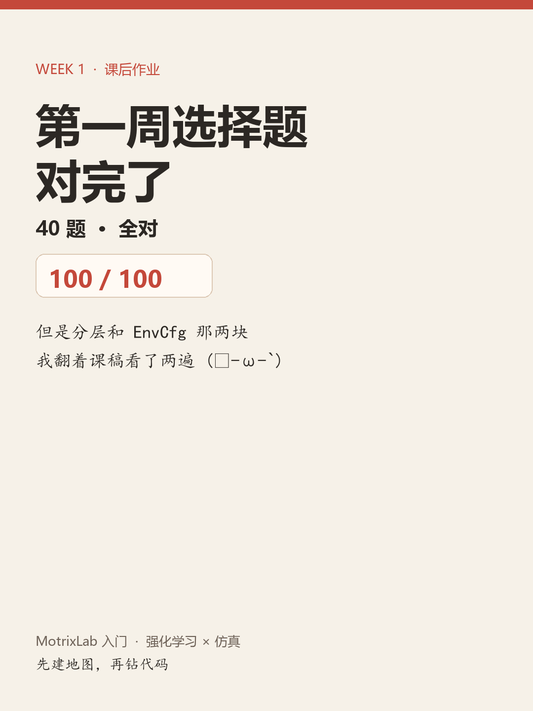
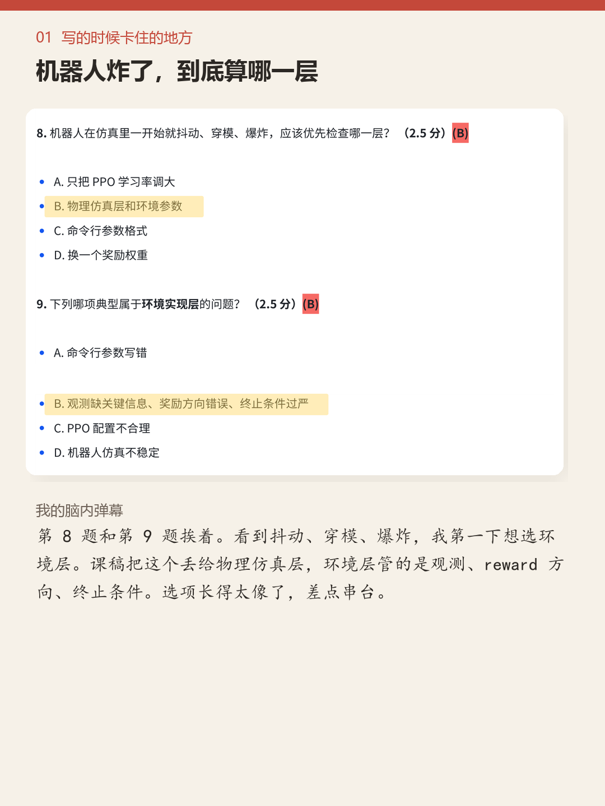
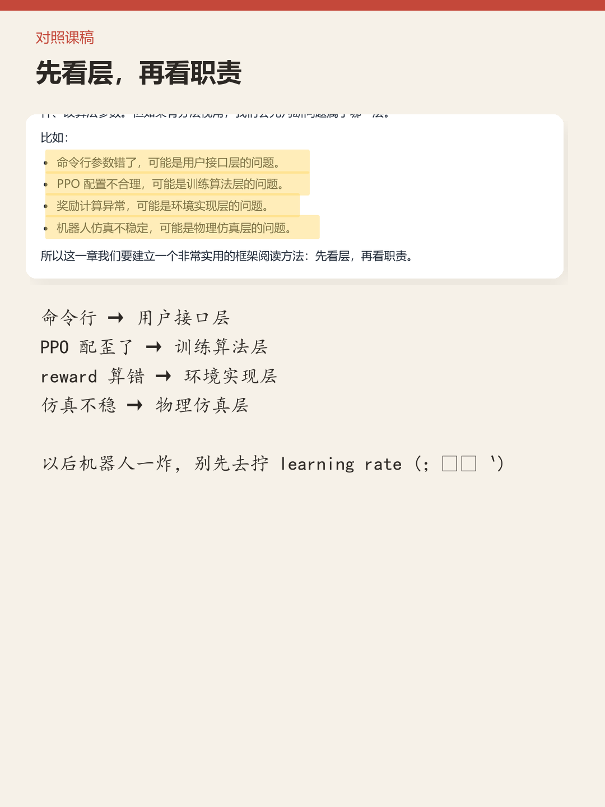
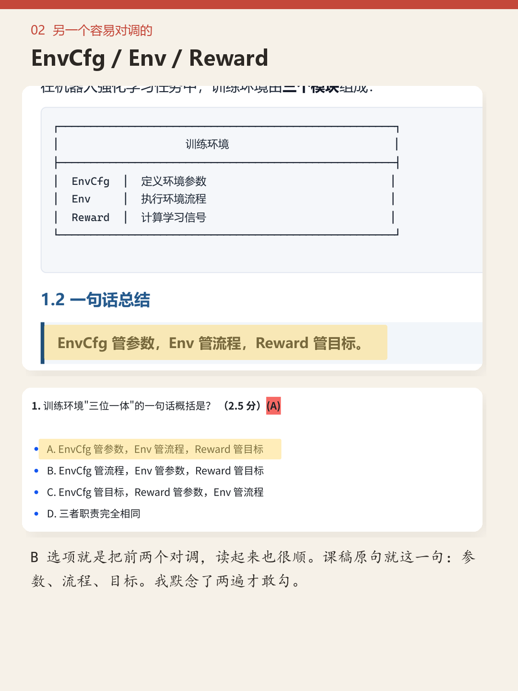
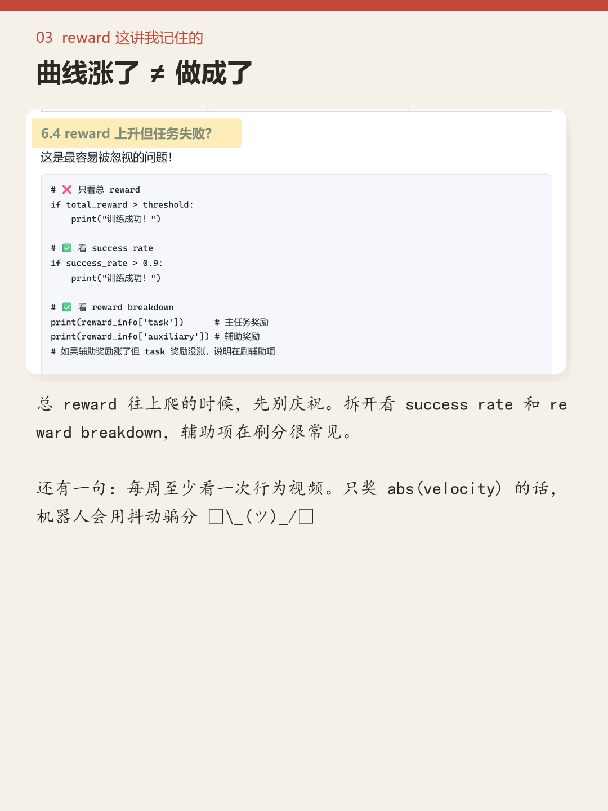

# 小红书文案 · 第一周作业

## 标题

推荐：

> 机器人一炸，先别拧学习率

备选：

- 全对了，但分层差点串台
- 入门第一周，我只记住这3句

封面用这张：

## 正文

40 道选择题对完，全对。
真卡住的就两处，选项都长得太像 (´-ω-`)

做机器人强化学习，难的往往不是公式，是搞错问题在哪一层。

**1. 抖动、穿模、爆炸，先看物理层**

我第一反应是环境写坏了。
课稿把这个丢给物理仿真层，还有环境参数。
环境实现层管的是另一摊：观测缺信息、reward 方向反了、done 太严。
第 8 题和第 9 题挨着出，差点串台。
以后机器人一炸，别先去拧 learning rate。

作业上这两题：

课稿里的对照：

**2. EnvCfg / Env / Reward，别把前两个对调**

错选项就是把「参数」和「流程」换个位置，读起来居然也顺。
就记这句：
EnvCfg 管参数，Env 管流程，Reward 管目标。
我默念了两遍才勾。
顺便，sim_dt 是物理步长，ctrl_dt 才是控制步长。

**3. 曲线在涨，不等于任务做成了**

先看 success rate，再拆 reward breakdown。
辅助项自己往上爬，就是在刷分。
只奖 abs(velocity) 的话，机器人会用抖动骗分 ¯\\_(ツ)_/¯
所以每周至少看一次行为视频，这个我认。

第一周的口令就留这句：先建地图，再钻代码。

你做仿真的时候机器人炸过吗？先查的哪一层，评论区说说👇

## 话题

`#MotrixLab` `#强化学习入门` `#机器人仿真` `#学习笔记` `#作业复盘`

## 发布顺序

1. 封面
2. 分层两题
3. 四层对照
4. 三位一体
5. reward
