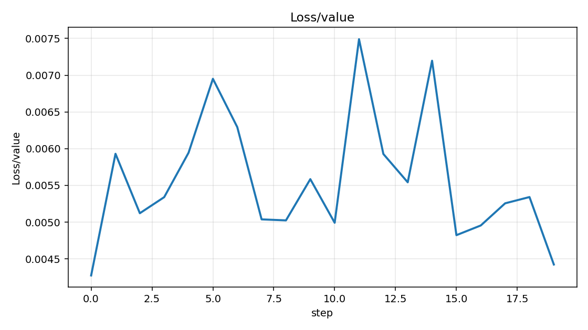
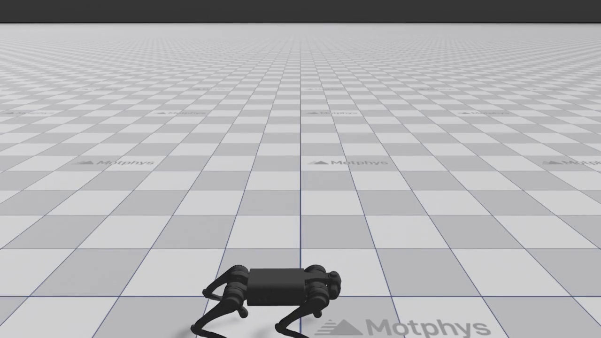
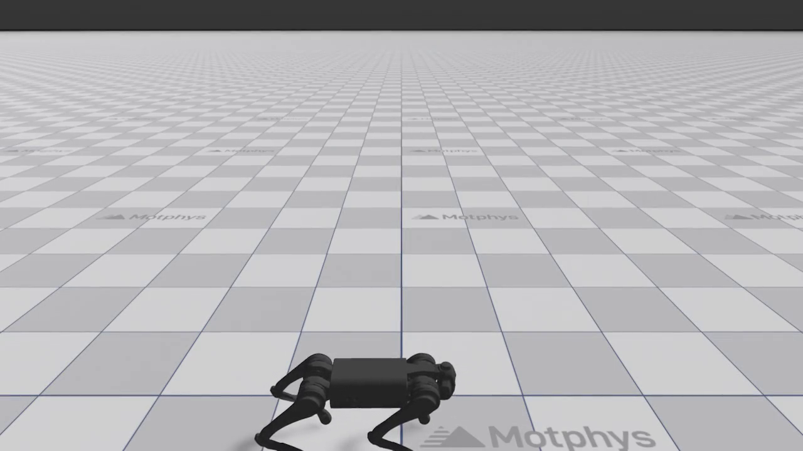
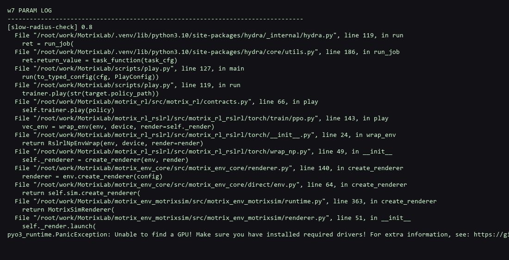

# 小红书文案 · 第七周（Go1 路点导航 + slow_radius A/B）

素材：同目录 png（Loss / play A·B / 参数日志）+ 可选飞书作业截图。  
环境：MotrixLab **v0.4.0b1** · go1-waypoint-flat · rslrl / torch / cuda

## 标题

推荐：

> 第七周：减速半径变大，靠近目标时更「怂」

备选：

- 路点导航：A→B→C，不只是往哪走
- slow_radius 0.8→1.6，接近系数直接腰斩
- 只改 logic 默认值？环境根本不吃这套

封面建议：`01_Loss_value.png`，或 `02_play_A.png` / `03_play_B.png` 拼对比

---

## 正文（直接复制）

第七周任务：Go1 路点导航，跟着 A→B→C 走。

作业三块：
路点基础题 → 训通闭环 → slow_radius A/B。

一句话先丢出来：
**导航不只问「往哪走」；靠近目标时怎么减速，本身就是任务设计。**

---

### 一、先把短训闭环记清楚

训练：32 环境、20 iter。

运行目录：
`runs/go1-waypoint-flat/rslrl/torch/ppo/26-10-30_08-23-40-867714`

`Loss/value` 大约在 0.0043～0.0044 晃——点少，别急着判收敛。

回放观察：
有朝当前路点 A 走的趋势；短训下未必稳稳走完 B、C，更别说在 C 连续站稳。  
没走完也如实写。

---

### 二、slow_radius：接近系数一眼就能算

调用链：
cfg `WaypointTaskCfg.slow_radius`  
→ env `_update_goal_commands()` 显式传入  
→ logic `approach_factor = clip(distance / slow_radius, 0, 1)`

固定输入：目标在前方 0.4 m，linear_kp=0.8，max_forward=0.6。

**A：slow_radius=0.8**  
approach = 0.4/0.8 = **0.5** → vx = **0.16**

**B：slow_radius=1.6**  
approach = 0.4/1.6 = **0.25** → vx = **0.08**

半径变大，同一距离下更早开始「收油门」。  
日志：`[slow-radius-check] 0.8` / `1.6`。

还有一道坑：
只改 `logic.py` 函数默认值、却保留 cfg + env 显式传参——**不会生效**。  
环境用的是 cfg 传进来的值。

---

### 三、这周心得

1. **减速是设计，不是玄学。** slow_radius 直接进接近系数。  
2. **算完再回放。** 0.5→0.25、0.16→0.08，数字比观感硬。  
3. **指令变小 ≠ 实际同比例变慢。** 中间还有策略和物理。  
4. **改默认值要看调用链。** env 显式传参时，函数默认值是摆设。  
5. 第七周像在说：会走之后，还要会「走近了怎么收」。

靠近目标也要有章法。第七周过了 ✧

同进度在做 slow_radius 的，评论区扣「减速」，我把接近系数那行公式贴你。

#MotrixLab #强化学习入门 #四足机器人 #路点导航 #对照实验 #具身智能 #PPO #学习笔记 #作业复盘

---

## 配图顺序（按正文）

1. `01_Loss_value.png` — 封面 / Loss  
2. `02_play_A.png` — A 组回放（slow_radius=0.8）  
3. `03_play_B.png` — B 组回放（slow_radius=1.6）  
4. `04_param_A.png` — A 参数日志  
5. `05_param_B.png` — B 参数日志  

## 评论区置顶

1. 版本：MotrixLab v0.4.0b1；task=`go1-waypoint-flat`  
2. 训练：`num_envs=32 algo.max_iterations=20 seed=42`  
3. A/B：只改 `slow_radius` 0.8 → 1.6；同一 checkpoint  
4. 公式：`approach = clip(distance/slow_radius,0,1)`；0.4m 时 0.5→0.25  
5. 口令：改默认值前先看 env 有没有显式传参  
