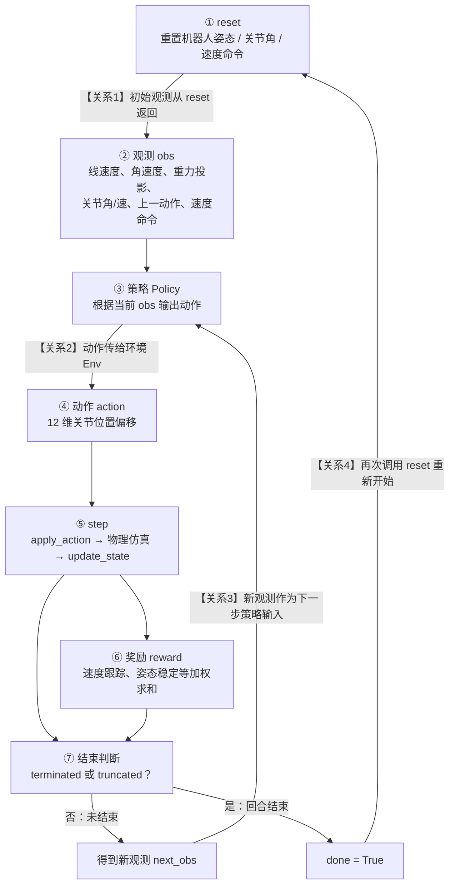

# 第2题 · 一回合交互流程图（四足 / GO1）

姓名：于鸿伟  
对应：第三周作业第 2 题（12 分）  
环境参考：MotrixLab `go1-flat-terrain-walk`（Unitree GO1）

---

## 一、一回合交互流程图

下面用 Mermaid 画出一个 episode 内的闭环。箭头旁标注了四条得分关系。



---

## 二、四条关系说明（每条 3 分）

| 编号 | 关系 | 箭头含义 |
| ---: | ---- | -------- |
| 1 | 初始观测从哪里来 | `reset()` 后环境返回初始 `obs`，作为本回合策略的第一次输入 |
| 2 | 动作传给了谁 | 策略输出的 `action` 传给**环境 Env**（GO1 里经 PD 变成 12 个关节力矩，再驱动四条腿） |
| 3 | 新观测怎样用于下一步 | `step` 结束后得到 `next_obs`，**下一轮直接作为策略输入**，形成循环 |
| 4 | 回合结束后怎样重新开始 | `terminated` 或 `truncated` 为真时，调用 `reset()`，拿到新的初始观测，开始下一回合 |

---

## 三、文字版流程（方便对照手绘）

```
reset
  ↓  （关系1：给出初始观测）
观测 obs
  ↓
策略 Policy
  ↓  （关系2：动作交给环境）
动作 action
  ↓
step（仿真推进）
  ↓
奖励 reward  +  结束判断
  ├─ 未结束 → 新观测 next_obs ──→ 再进策略  （关系3）
  └─ 已结束 → reset 重新开始              （关系4）
```

---

## 四、和代码的对应位置（自查用）

- 通用闭环：`motrix_envs/src/motrix_envs/np/env.py` 的 `step()` / `_reset_done_envs()` / `_update_truncate()`
- 四足具体逻辑：`motrix_envs/src/motrix_envs/locomotion/go1/walk_np.py` 的 `apply_action` / `update_state` / `update_terminated`
- 任务说明：`docs/source/zh_CN/user_guide/demo/locomotion_unitree_go1.md`

---

## 五、交作业提示

- 可直接截本页 Mermaid 图，或按「三、文字版」手绘拍照。
- 图上请标出 **reset / 观测 / 策略 / 动作 / step / 奖励 / 结束判断** 七个环节。
- 四条关系用带序号的箭头标清即可。
