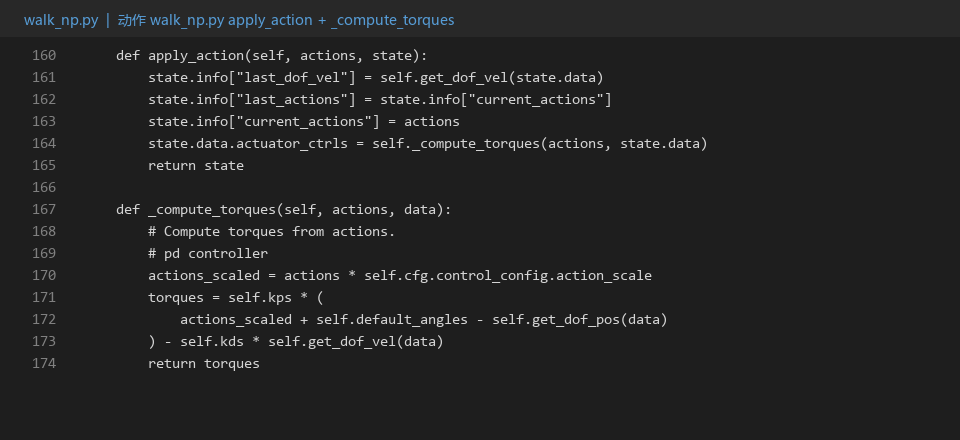
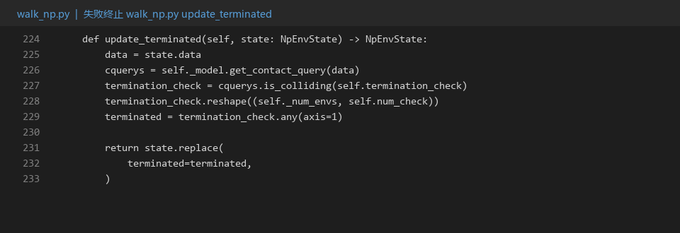
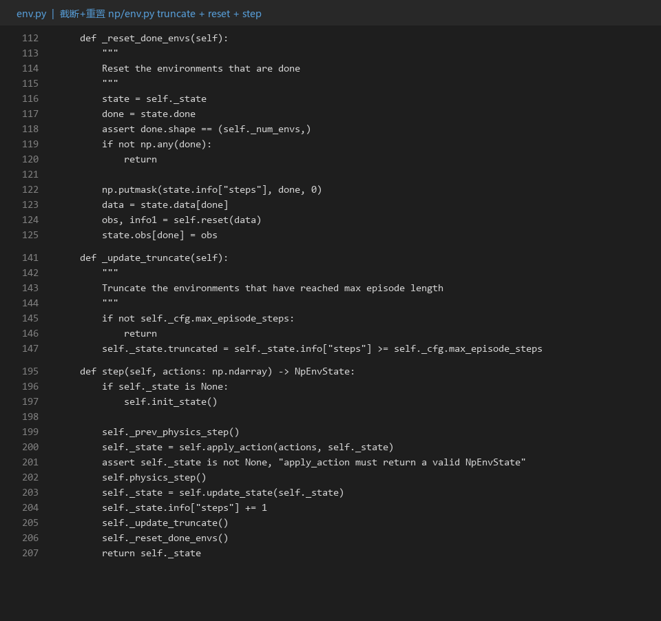
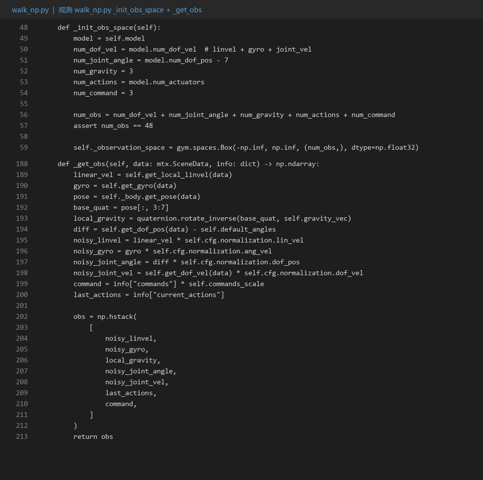
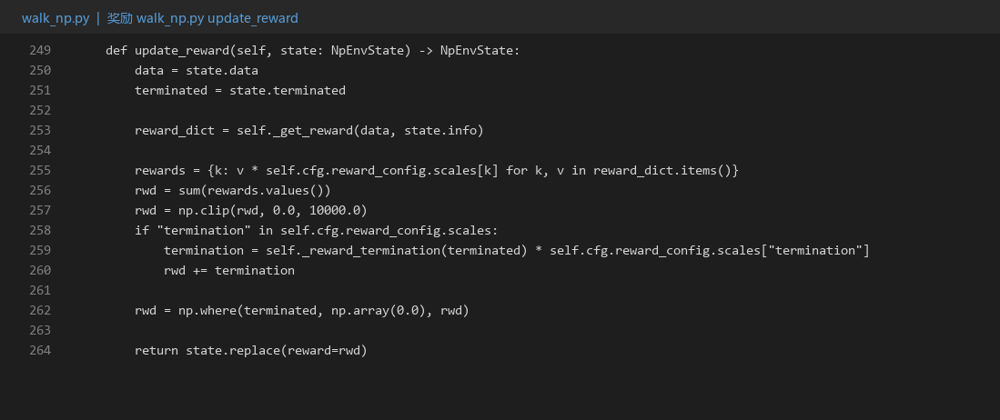

# 小红书文案 · 第三周（环境八要素 · GO1）

素材：同目录 png（观测 / 动作 / 奖励 / 终止代码截图）+ 飞书作业里的交互流程图。

## 标题

推荐：

> 第三周：别急着训，先把环境拆成 8 块

备选：

- terminated 和 truncated，我以前一直混
- GO1 不是黑盒，48 维观测我对着代码数过
- 文档写了「有噪声」，代码里没有：以代码为准

封面建议：`02_action.png`（PD→力矩，一眼像实操）

---

## 正文（直接复制）

第三周 MotrixLab，作业标题还写着 CartPole，
我实际拆的是 **Unitree GO1 平地行走** `go1-flat-terrain-walk`。
这周不要求训练，要求你把环境拆开看。

一句话先丢出来：
**别急着拧学习率，先把「机器人看见什么、做什么、什么时候死、超时算不算死」对齐。**

---

### 一、一个回合怎么转起来

作业要画交互图：reset → 观测 → 策略 → 动作 → step → 奖励 → 结束判断。

四条箭头我记成口令：

1. 初始观测从 **reset** 来  
2. 动作交给 **Env**，不是交给空气  
3. 新观测 `next_obs` 再喂回策略  
4. done 了就再 **reset**，开下一回合  

听起来像废话，对着 `np/env.py` 的 `step()` 看一遍就不虚了。

---

### 二、terminated ≠ truncated（我以前真混）

**terminated**：任务失败，自然结束。  
GO1 例子：躯干 `trunk` 撞地摔倒。

**truncated**：时间到了被截断，不是失败。  
GO1 例子：走满约 20 秒还没摔，`20 / 0.01 = 2000` 步，截断。

两者任一为真都算回合结束，都会触发重置。
但训练里语义不一样——失败往往要「归零心态」，超时有时还要继续 bootstrap。
混着写，价值函数会学歪。

---

### 三、八要素表，我是对着代码填的

作业要「要素｜答案｜来源」三列，每行两个问题。
原则写在卷面上：**以实际代码为准；文档有、代码没有 → 写未实现。**

我这周 GO1 的硬结论：

**智能体**  
控 12 个腿关节（hip/thigh/calf），经 PD 变力矩。  
吃 48 维观测，吐 12 维动作（相对默认站姿的偏移）。

**观测 48 = 3+3+3+12+12+12+3**  
线速度 / 角速度 / 局部重力 / 关节角偏差 / 关节速度 / 上一动作 / 速度命令。

**动作路径**（这题最容易写飘）  
策略输出 →（clip_actions：无）→ ×0.05 → +默认角 → PD → 写入 12 个 motor（ctrlrange ±23.7，无 gear）→ 关节力矩。

**奖励**  
不是简单每步 +1，是一堆子项加权再 clip；摔倒当步直接置 0。  
鼓励：跟速度命令、稳步态、少乱扭。

**域随机化**  
真落地的主要是：reset 时重采样速度命令。  
文档里的关节噪声、观测 NoiseConfig——平地 `walk_np.py` 里我没找到实现，就老实写了「未实现」。

---

### 四、这周踩的坑 / 心得

1. **题目模板 ≠ 你的环境。** 卷面写 CartPole，我拆 GO1，答案要跟代码对齐，别背范文。  
2. **文档会骗人，代码不会。** 「有噪声」「超速终止」文档有，平地实现没有，就标未实现并写查找位置。  
3. **动作不是「影响场景」这种空话。** 要写到部件：哪几个关节、什么物理量、有没有缩放/裁剪。  
4. **terminated / truncated 分清，比多背一个公式管用。**  
5. 第三周像在给环境做体检：先建地图，再谈训练。

先拆清楚，再谈训得动。第三周过了 ✧

同进度在拆八要素的，评论区扣 1，我把 GO1 观测 48 维顺序丢你。

#MotrixLab #强化学习入门 #机器人仿真 #四足机器人 #UnitreeGO1 #学习笔记 #作业复盘 #具身智能

---

## 配图顺序（按正文）

1. `02_action.png` — 封面  
2. `04_terminated.png` — 失败终止  
3. `05_truncate_reset.png` — 截断重置  
4. `01_obs.png` — 观测  
5. `02_action.png` — 动作（可与封面复用，或只发一次）  
6. `03_reward.png` — 奖励  

可选：再贴一张飞书里的交互流程图截图，放在「一个回合怎么转」后面。

## 评论区置顶

1. 环境：`go1-flat-terrain-walk`，MotrixLab v0.3.0  
2. 观测 48 维顺序：linvel3 + gyro3 + gravity3 + joint_pos12 + joint_vel12 + last_action12 + cmd3  
3. 截断：`max_episode_seconds=20`，`ctrl_dt=0.01` → 2000 步  
4. 口令：以代码为准；文档有代码无 → 写未实现  
