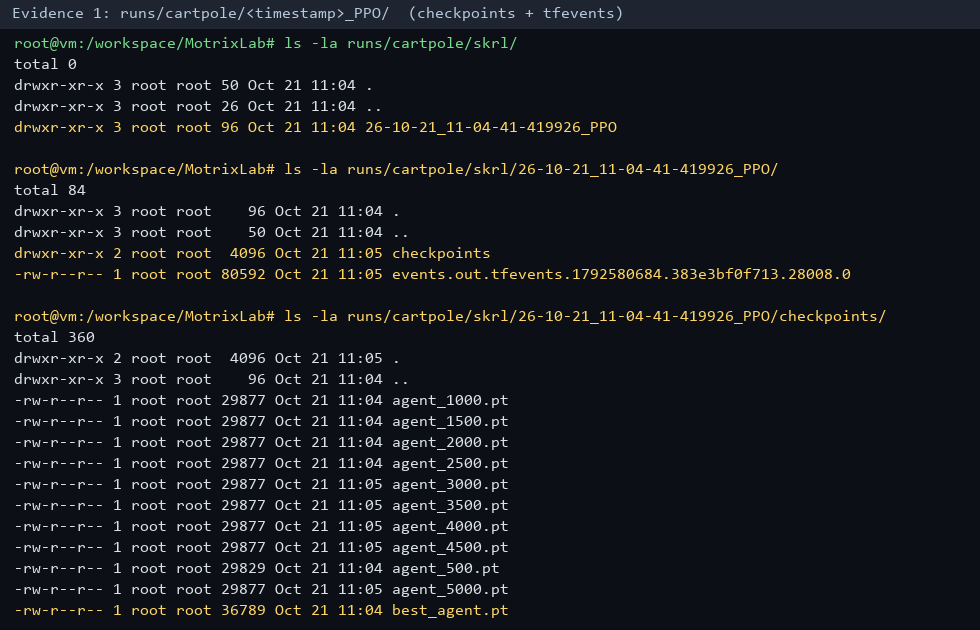
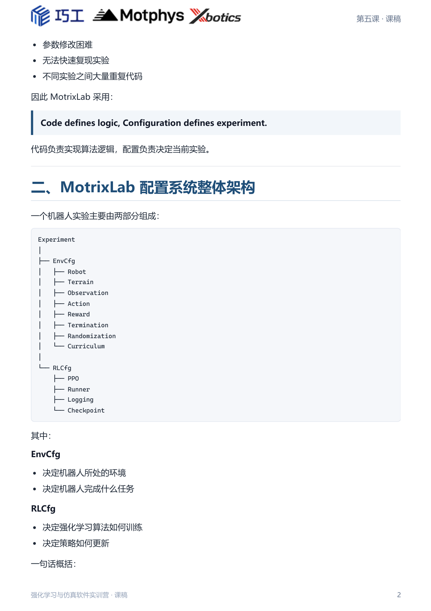
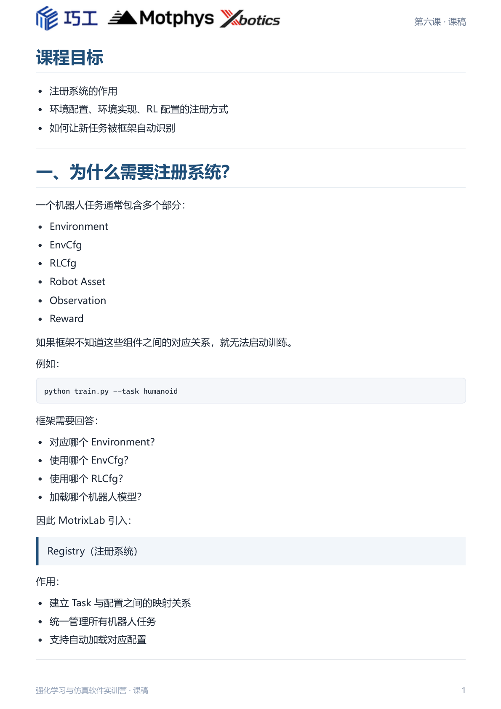
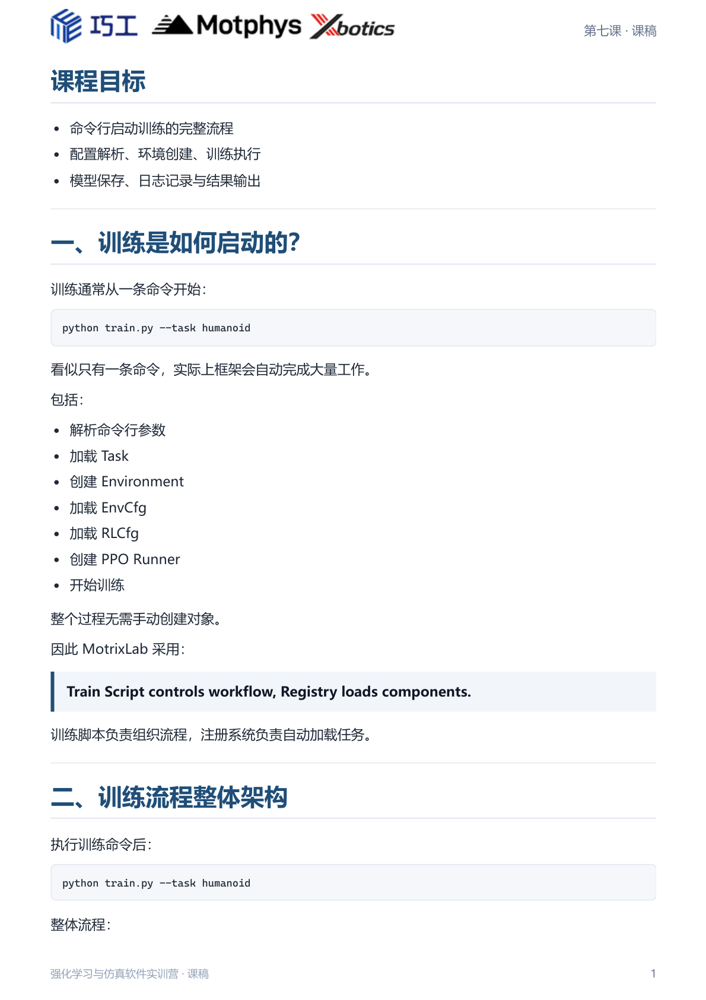
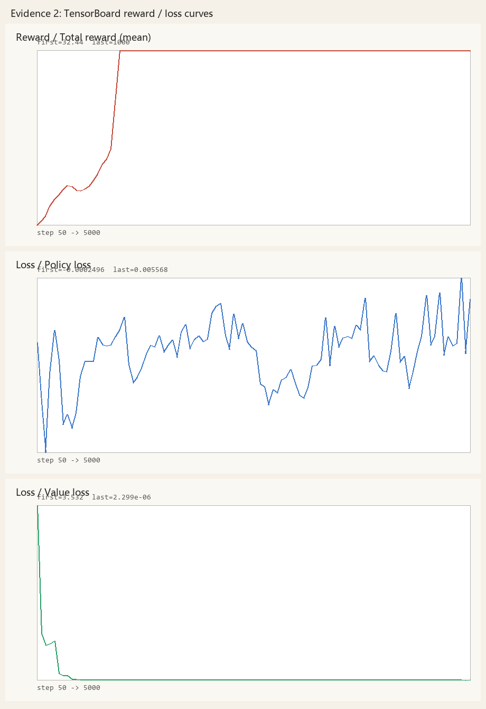
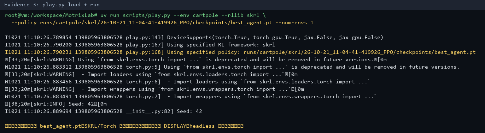

# 小红书文案 · 第二周（第5~7讲 + 实操）

素材来源：本目录上一级的第5~7讲课稿 + cartpole 实操证据图（同目录 png）。

## 标题

推荐：

> 第二周 MotrixLab：配置、注册、训练全踩一遍

备选：

- EnvCfg 决定世界，RLCfg 决定学习
- cartpole 训通了，坑几乎全在装环境
- 从 train.py 到 checkpoint，我走通了

封面建议：`01_runs_directory.png`（有 runs 最有实操感）

---

## 正文（直接复制）

第二周 MotrixLab 入门，终于从选择题走到「真的把训练跑起来」。

这周三讲连在一起看才顺：
第5讲配置系统 → 第6讲注册系统 → 第7讲训练流程。
前面两讲偏读懂框架，第7讲是红线实操：目录截图、TensorBoard、play 加载，少一条都不过 (´-ω-`)

一句话先抛出来，我这周记最牢的：
**Code defines logic, Configuration defines experiment.**
代码管逻辑，配置管这次实验长什么样。

---

### 一、第5讲：配置系统，我以前最容易混

课稿把实验拆成两块：

**EnvCfg 决定世界，RLCfg 决定学习。**

EnvCfg 这边装的是环境/任务：
Robot、Terrain、Observation、Action、Reward、Termination、Randomization、Curriculum……
机器人看见什么、能做什么、什么时候 episode 结束、奖励怎么打，都在这。

RLCfg 这边装的是训练：
learning_rate、gamma、clip、rollout、Runner、Logging、Checkpoint……
它不改任务本身，只改「机器人怎么学」。

以前我改实验，喜欢直接在代码里硬写：
`learning_rate = 3e-4`、`num_envs = 4096`
结果就是：难复现、难对比、复制粘贴一堆。
配置系统就是把这件事拆开——同一套代码，换配置就能开另一组实验。

还有个小点我后来才品出来：
改 reward 权重，多半动 EnvCfg；
改 PPO 学习率，动 RLCfg。
别再一股脑全往 train.py 里塞。

---

### 二、第6讲：注册系统，框架怎么「找到你」

注册系统解决的是：
你敲 `train.py --env cartpole` 的时候，框架怎么知道去拉哪个 Env、哪个 EnvCfg、哪个 RLCfg。

课里的结构很清楚：
Task Name → Registry → Environment / EnvCfg / RLCfg → 开始训练。

三部分缺一个都起不来。
而且名字要一致，`__init__.py` 的 import 链不能断——装饰器没执行，框架就当你没写过这个任务。

以前我以为「代码写了就存在」。
现在知道：**没注册 = 框架看不见。**

创建新任务的路径课上也给了：
复制已有 task → 改名 → 改 Env/Cfg/RLCfg → 在 `__init__.py` 注册 → 再训练。
不用去改框架主体，这点挺工程。

---

### 三、第7讲：训练流程，一条命令背后在干嘛

看起来只是：
`uv run scripts/train.py --env cartpole`

背后其实是：
解析参数 → Registry 找任务 → 加载 EnvCfg/RLCfg → 创建 Environment → 创建 Runner → 采样 → PPO 更新 → 写 checkpoint / 日志。

课稿那句我也抄下来了：
**Train Script controls workflow, Registry loads components.**
脚本管流程，注册系统管自动装零件。

训练循环就是经典那套：
obs → policy → action → env → reward → buffer → PPO update → new policy
循环到 max_iterations，中途按间隔存 checkpoint，日志进 TensorBoard。

所以第7讲作业不是为难你训满一千万步，是逼你亲手走完：
**train 出目录 → 曲线能解释 → play 能加载。**

---

### 四、实操里我真实踩的坑（血泪）

理论听懂了，上云主机还是挨了一顿打 ¯\\_(ツ)_/¯

**坑1：仓库版本不对**
作业命令是 `scripts/train.py --env cartpole`。
main 分支已经改成 mxlab CLI 了，根本没有这两个脚本。
解决：用 **MotrixLab v0.3.0**。版本不对，后面全白忙。

**坑2：uv sync 慢到怀疑人生**
空机器从头装，motrixsim 下得很慢，.so 能涨到一两百兆。
别急着重启。看临时文件还在变大，就说明还活着：
`ls -lah ~/.cache/uv/.tmp*/motrixsim/*.so`

**坑3：训练其实很快**
环境摆平后：
`uv run scripts/train.py --env cartpole --num-envs 256 --train-backend torch`
默认大概 5000 timesteps，几十秒闭环。
产物在 `runs/cartpole/skrl/<时间戳>_PPO/`，里面有 checkpoints 和 tfevents。
难的不是训，是装。

**坑4：曲线要会读，不能只说「涨了」**
`uv run tensorboard --logdir runs/cartpole`
我重点看 Total reward (mean)、Policy loss、Value loss。
这次短训：reward mean 大概 32 → 1000，value loss 掉得很狠。
一句话：策略开始稳住倒立摆了。
但课里那句继续留着——曲线涨 ≠ 一定做成了，复杂任务还要看 success rate / breakdown / 行为视频。

**坑5：play 一跑就崩，以为模型废了**
日志前面其实已经成功：
`Using specified policy: .../best_agent.pt`
后面 panic：`DISPLAY is set` / `RenderClosedError`。
不是 checkpoint 坏了，是云主机没桌面，默认要开渲染窗。
解决：`scripts/play.py` 里 `enable_render = True` 改成 `False`。
另外 v0.3.0 指定 `--policy` 时必须带 `--rllib skrl`。

---

### 五、这周心得

1. 机器人强化学习入门，工程组织占比比想象大。公式要懂，但卡人的经常是版本、依赖、注册、显示环境。
2. 配置和注册是两把钥匙。EnvCfg/RLCfg 分清职责，Registry 把任务串起来，train.py 才不是魔法。
3. 交付意识很重要。不是「我感觉训过了」，而是目录在不在、曲线能不能讲、play 能不能加载。
4. 慢步骤要会自检。下载看文件大小，训完先 ls runs，play 挂了先分 DISPLAY 还是权重问题。
5. cartpole 只是门票。但它让我第一次完整走完 MotrixLab 最小闭环，后面改 reward、接新环境，至少知道该往哪找。

先建地图，再钻代码。第二周过了 ✧

同进度卡装环境 / play 崩的，评论区扣 1，我把版本号和 headless 改法丢你。

#MotrixLab #强化学习入门 #机器人仿真 #学习笔记 #配置系统 #注册系统 #作业复盘 #踩坑记录 #具身智能

---

## 配图顺序（按正文）

1. `01_runs_directory.png` — 封面
2. `lesson05_envcfg_rlcfg.png` — 第5讲配置
3. `lesson06_registry.png` — 第6讲注册
4. `lesson07_train_flow.png` — 第7讲训练流程
5. `02_tensorboard_curves.png` — 曲线
6. `03_play_result.png` — play 结果

> 小红书一次最多 18 张，上面 6 张刚好；若嫌多，可删课稿截图，只留 1/5/6 三张实操图。

## 评论区置顶

1. 作业命令对应 **MotrixLab v0.3.0**，main 没有 `scripts/train.py`  
2. 云主机 play 崩 DISPLAY：把 `enable_render` 改 False  
3. 指定 policy 必须加 `--rllib skrl`  
4. 记两句：EnvCfg 决定世界，RLCfg 决定学习；脚本管流程，注册管装零件
