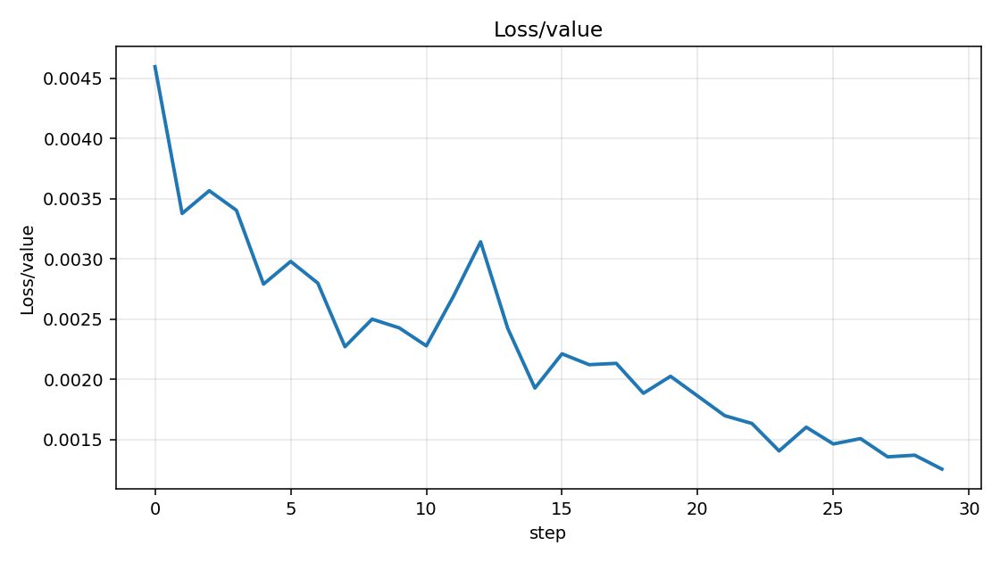
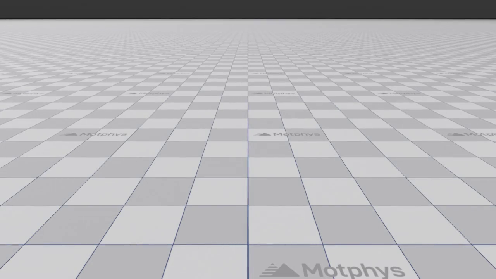
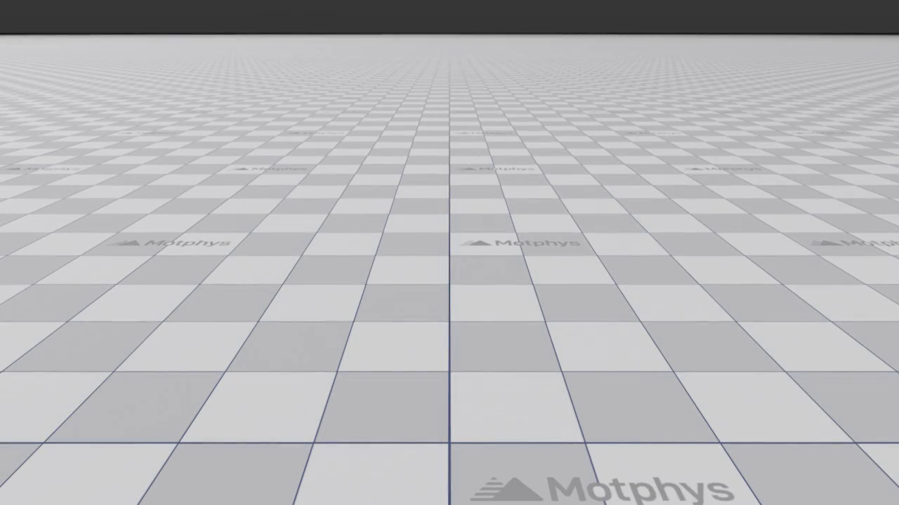
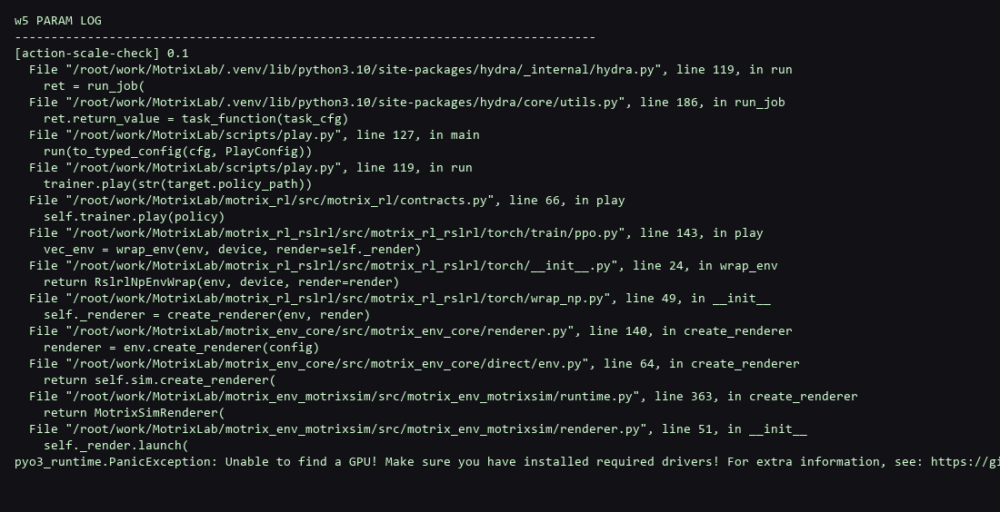

# 小红书文案 · 第五周（Go1 平地训练 + action_scale A/B）

素材：同目录 png（Loss / play A·B / 参数日志）+ 可选飞书作业截图。  
环境：MotrixLab **v0.4.0b1** · go1-walk-flat · rslrl / torch / cuda

## 标题

推荐：

> 第五周：动作缩放减半，关节目标真的跟着缩

备选：

- Go1 平地：先把训→看→放跑通再说
- action_scale 0.1→0.05，偏移刚好一半
- 四足入门：同一 checkpoint，只改执行缩放

封面建议：`01_Loss_value.png`，或 `02_play_A.png` / `03_play_B.png` 拼对比

---

## 正文（直接复制）

第五周 MotrixLab，从经典控制切到四足：Go1 平地走。

作业三块：
选择题打底 → 小规模 PPO 训通闭环 → action_scale A/B。

一句话先丢出来：
**先把「训得动、看得懂、回得放」跑通；再谈参数，才知道自己在改什么。**

---

### 一、这周我先把链路跑通

版本：MotrixLab 0.4.0b1 + CUDA + rslrl。

训练（小规模练习）：
64 环境、30 iter、seed=42。

运行目录：
`runs/go1-walk-flat/rslrl/torch/ppo/26-10-30_08-18-55-603922`

TensorBoard 看 `Loss/value`：
短训里大约从 0.0046 掉到 0.0013，还有波动——正常，这周目标不是拉满性能。

然后用同一个 `latest.pt` 回放：
策略能加载、机身有抬腿/迈步；短训下仍会摇晃，甚至倒——照实记。

---

### 二、action_scale：我算清楚它改的是什么

cfg 里：`ControlConfig(action_scale=0.1)`  
env 里：`targets = exec_actions * action_scale + default_angles`

同一输入：默认角 0.9 rad，exec_action=0.5。

**A 组 scale=0.1** → 目标角 0.95，偏移 **0.05**  
**B 组 scale=0.05** → 目标角 0.925，偏移 **0.025**

B 的偏移刚好是 A 的一半。  
日志也打出来了：`[action-scale-check] 0.1` / `0.05`。

注意：偏移减半 ≠ 实际关节轨迹、行走速度一定同比例变。  
这次是对**固定策略**改执行参数，不是重训后的效果对比。

---

### 三、这周心得

1. **闭环优先。** 训 / TB / play 三步缺一，后面 A/B 都悬空。  
2. **改参先定位。** cfg 写在哪、env 怎么用，比盲改数字重要。  
3. **算一笔再回放。** 固定输入算清直接作用，再用日志确认生效。  
4. **区分「指令变化」和「行为变化」。** 短训画面差一点，不代表参数没生效。  
5. 第五周像在说：四足入门，先会跑通，再会对照。

训得动，才谈调得好。第五周过了 ✧

同进度在做 action_scale 的，评论区扣「缩放」，我把计算公式贴你。

#MotrixLab #强化学习入门 #四足机器人 #Go1 #对照实验 #具身智能 #PPO #学习笔记 #作业复盘

---

## 配图顺序（按正文）

1. `01_Loss_value.png` — 封面 / Loss 曲线  
2. `02_play_A.png` — A 组回放（scale=0.1）  
3. `03_play_B.png` — B 组回放（scale=0.05）  
4. `04_param_A.png` — A 参数日志  
5. `05_param_B.png` — B 参数日志  

可选：飞书答题卡截图，放在「这周心得」前。

## 评论区置顶

1. 版本：MotrixLab v0.4.0b1；backend：rslrl / torch / cuda  
2. 训练：`task=go1-walk-flat/rslrl.ppo num_envs=64 algo.max_iterations=30 seed=42`  
3. A/B：只改 `action_scale` 0.1 → 0.05；同一 checkpoint、同一 seed  
4. 计算：`target = 0.9 + scale×0.5` → 偏移 0.05 / 0.025  
5. 口令：对照只改一项；先确认日志生效，再谈画面差异  
