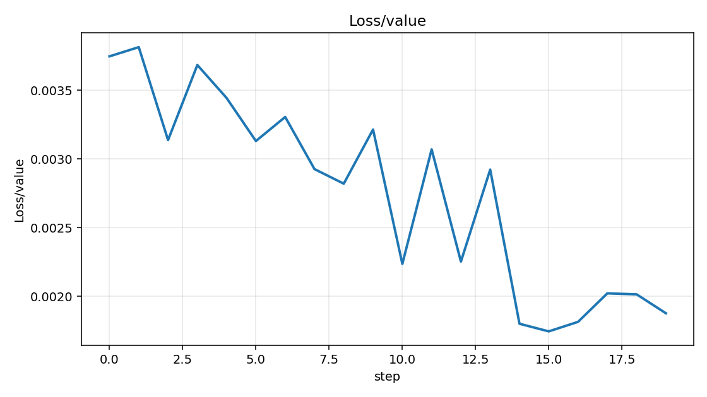
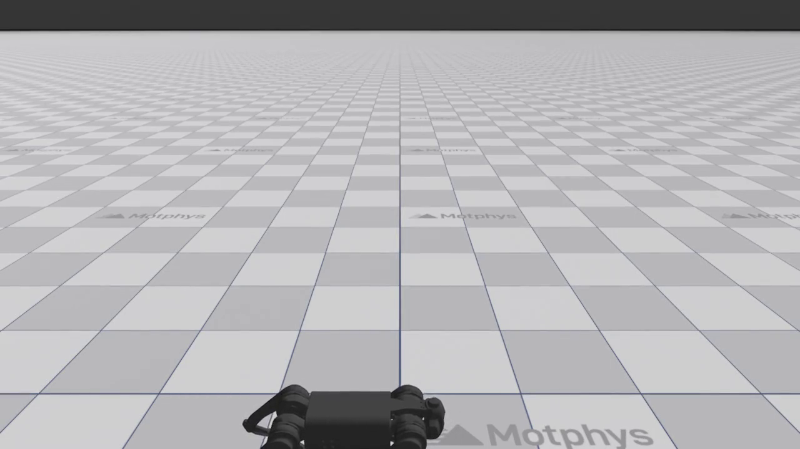
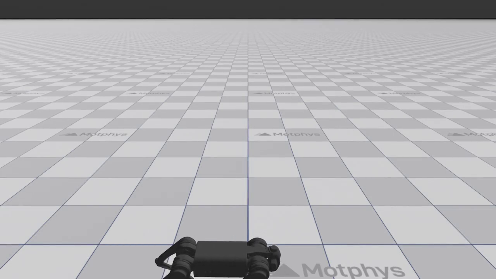
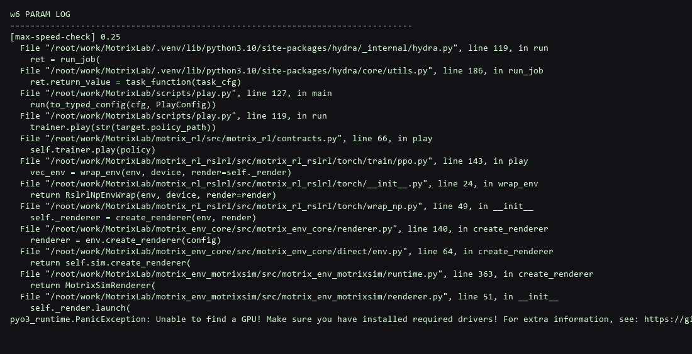

# 小红书文案 · 第六周（Go1 坡道平台 + max_speed A/B）

素材：同目录 png（Loss / play A·B / 参数日志）+ 可选飞书作业截图。  
环境：MotrixLab **v0.4.0b1** · go1-slope-platform · rslrl / torch / cuda

## 标题

推荐：

> 第六周：max_speed 砍半，指令先被限住了

备选：

- Go1 上坡：参数不在画面里，在日志里
- 同一模型，只改最大速度上限
- 远离目标时，限速才真正动手

封面建议：`01_Loss_value.png`，或 `02_play_A.png` / `03_play_B.png` 拼对比

---

## 正文（直接复制）

第六周换地形：Go1 坡道 + 平台停稳。

作业三块：
选择题（含站稳步数、平台高度）→ 训通闭环 → max_speed A/B。

一句话先丢出来：
**改速度上限，改的是「期望指令的天花板」；机身实际跑多快，还要过策略和物理这一关。**

---

### 一、闭环还是那三步，场景更难了

小规模训练：32 环境、20 iter。

运行目录：
`runs/go1-slope-platform/rslrl/torch/ppo/26-10-30_08-23-12-580158`

`Loss/value` 大约 0.0037→0.0019，有波动——短训别急着说收敛。

回放上：有朝目标走的趋势；但短训策略未必稳稳上坡，更别说平台上连续站稳 3 秒。  
没完成也照实写，这才是证据。

选择题里两道计算题我记一下：
连续站稳 3s、控制周期 0.02s → **150** 步；
平台高 0.5 + 目标离地 0.275 → **0.775** m。

---

### 二、max_speed：顺着 cfg → env 摸清楚

cfg：`PlatformTaskCfg.max_speed`  
env：`_update_goal_commands()` 里用 `task.max_speed` 限幅。

固定输入算一笔（position_gain=0.8，stop_radius=0.25）：

相对位置 `[2.0, 0]` → v_raw=`[1.6, 0]`  
- A max=0.5 → 指令 `[0.5, 0, 0]`（触发限速）  
- B max=0.25 → 指令 `[0.25, 0, 0]`（触发限速）

相对位置 `[0.3, 0]` → v_raw=`[0.24, 0]`  
两档上限都压不住它——**不触发**限速。

回放日志：
`[max-speed-check] 0.5` / `0.25`  
同一 checkpoint、同一 seed。短训画面差一点时，用日志 + 公式说话。

---

### 三、这周心得

1. **先定位再改。** cfg 字段、env 谁读，调用链说不清就别瞎调。  
2. **限速有条件。** 只有 `||v_raw||` 够大、还没进 stop 区，上限才改指令。  
3. **指令 ≠ 实际速度。** 期望砍半，身体不一定按比例变慢。  
4. **短训要诚实。** 没上稳平台也是结果；证据链比「看起来很牛」重要。  
5. 第六周像在说：地形难了，实验方法不能糊。

上限改明白，对照才站得住。第六周过了 ✧

同进度在做 max_speed 的，评论区扣「限速」，我把两组固定输入计算贴你。

#MotrixLab #强化学习入门 #四足机器人 #坡道行走 #对照实验 #具身智能 #PPO #学习笔记 #作业复盘

---

## 配图顺序（按正文）

1. `01_Loss_value.png` — 封面 / Loss  
2. `02_play_A.png` — A 组回放（max_speed=0.5）  
3. `03_play_B.png` — B 组回放（max_speed=0.25）  
4. `04_param_A.png` — A 参数日志  
5. `05_param_B.png` — B 参数日志  

## 评论区置顶

1. 版本：MotrixLab v0.4.0b1；task=`go1-slope-platform`  
2. 训练：`num_envs=32 algo.max_iterations=20 seed=42`  
3. A/B：只改 `max_speed` 0.5 → 0.25；同一 checkpoint  
4. 口令：限速看 `||v_raw||`；指令变化 ≠ 实际速度同比例  
